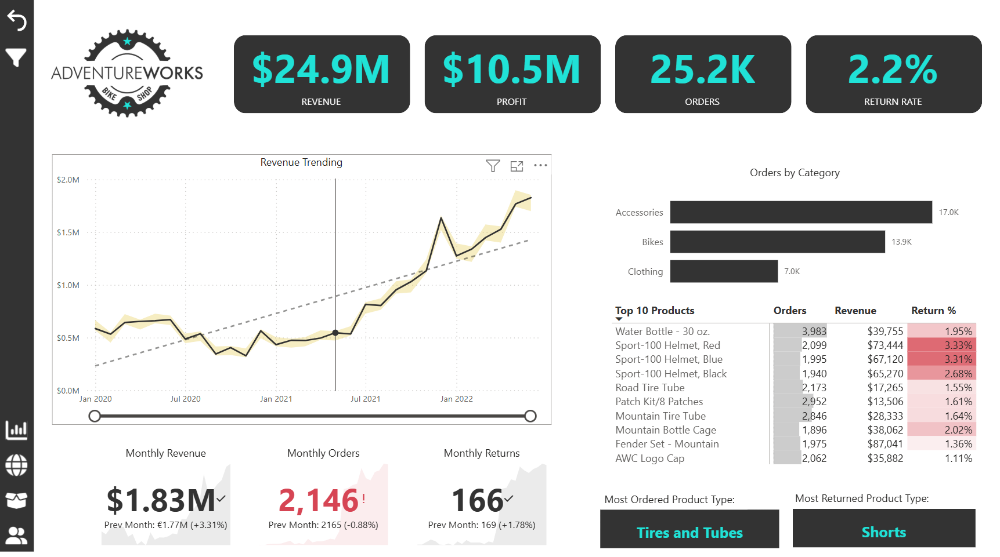
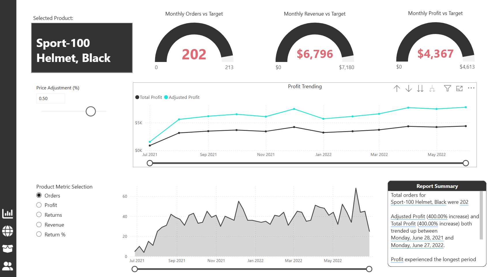
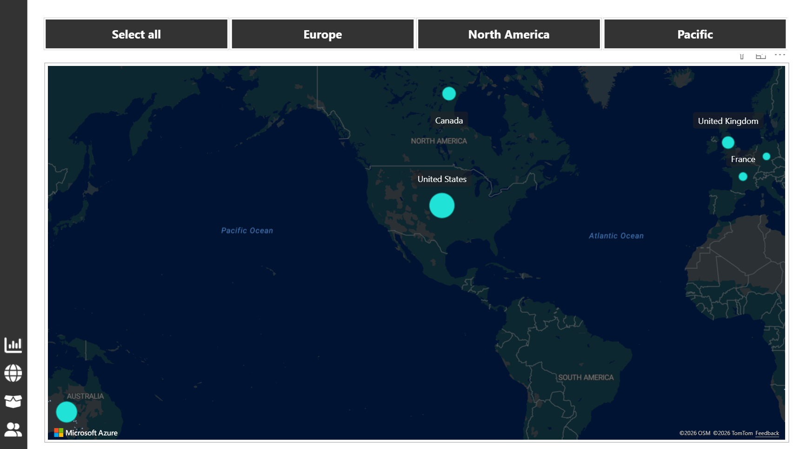
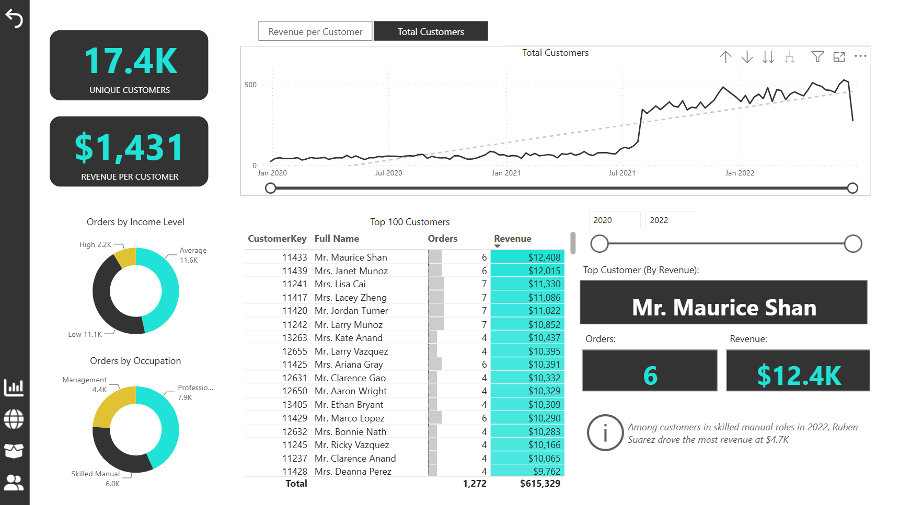

# 📊 Adventure Works Sales Analysis | Power BI

## 📌 Project Overview

This project explores sales performance using the Adventure Works sample dataset in Power BI. The aim was to bring sales, product, geographical, and customer information together in an interactive report.

The report is organised into four pages, each focusing on a different area of the business:

- 📈 **Executive Dashboard** – Revenue, orders, returns, profit trends, and monthly performance against targets.
- 🛍️ **Product Detail** – Product-level performance, orders, profit, returns, and price adjustment analysis.
- 🌍 **Map** – Geographical view of the countries and sales represented in the report.
- 👥 **Customer Details** – Customer segments, revenue per customer, unique customers, and top customers by revenue.

## 🛠️ Tools & Technologies

- **Power BI Desktop** – Report development and interactive visualisations.
- **Power Query** – Data cleaning and transformation.
- **DAX** – Measures and calculations for sales KPIs.
- **Data Modelling** – Relationships between tables and filter behaviour.
- **Interactive Reporting** – Drill-through, buttons, actions, slicers, and report navigation
- **Row-Level Security (RLS)** – Configuring and testing role-based data access.
- **Power BI Visuals** – KPI cards, charts, tables, slicers, and maps.
- **Power BI AI Visuals** – Smart Narrative and anomaly detection for summarising trends and highlighting unusual changes in data.

## 🔍 Approach

### 📊 1. Executive Dashboard

Created a high-level view of sales performance to make key metrics easier to monitor.

- Displayed revenue, orders, and return metrics.
- Analysed monthly revenue, orders, and profit trends.
- Included comparisons against previous periods and targets.
- Highlighted top products and key business metrics.
- Applied anomaly detection to highlight unusual changes in revenue trends over the years.

### 🛍️ 2. Product Detail Analysis

Focused on understanding product performance and the metrics behind it.

- Examined product orders, profit, returns, and return rates.
- Included product selection drill-through to explore individual products.
- Added a price adjustment feature to examine changes in selected product metrics.
- Used Smart Narrative to generate text-based summaries of report insights.

### 🌍 3. Geographical Analysis

Used a map visual to explore the geographical distribution of the business.

- Displayed countries and regions represented in the report.
- Provided a geographical view to support exploration of sales performance.

### 👥 4. Customer Analysis

Explored customer contribution to sales and differences between customer groups.

- Analysed unique customers and revenue per customer.
- Examined orders by income level and occupation.
- Highlighted top customers by revenue.

### ⚙️ 5. Data Preparation, Modelling & DAX

Worked on the data and calculations needed to support the report.

- Cleaned and transformed data using Power Query.
- Created relationships between relevant tables.
- Developed DAX measures for revenue, orders, profit, returns, and return rate.
- Used measures to support trend analysis and comparisons against targets.

### 🔐 6. Row-Level Security

Implemented and tested Row-Level Security (RLS) to control access to report data based on configured roles.

## 📊 Results

- Brought sales, product, geographical, and customer analysis together in one Power BI report.
- Made it possible to explore monthly performance and compare key metrics against targets.
- Added product-level analysis for examining orders, profitability, and returns.
- Included customer insights such as revenue per customer, customer segments, and top customers.
- Added interactive product selection and price adjustment functionality.
- Implemented and tested role-based data access.

## 📸 Visuals

### 📈 Executive Dashboard

Shows the main sales KPIs, monthly trends, target comparisons, and top products.

### 🛍️ Product Detail

Shows product-level metrics and the interactive price adjustment feature.

### 🌍 Geographical Map

Shows the geographical view included in the report.

### 👥 Customer Details

Shows customer metrics, customer segments, and top customers by revenue.

## 📂 Project Files

- 📊 [**Power BI Report (.pbix)**](./Adventure%20Works%20Report.pbix) – Download and open in Power BI Desktop.
- 📄 [**PDF Report Preview**](./Adventure%20Works%20Report%20-%20PDF%20Preview.pdf) – View a static version of the report.
- 🗂️ [**Datasets**](./datasets/) – Supporting dataset files, where included.
- 🖼️ [**Images**](./images/) – Report Logos.
- 🖼️ [**Screenshots**](./Screenshots/) – Screenshots of the four report pages.

## 🚀 How to Explore the Project

1. Download the Power BI report from the link above.
2. Open the `.pbix` file in Power BI Desktop.
3. Navigate through the four report pages.
4. Use the available filters and interactive visuals to explore the data.

Alternatively, view the PDF preview to see the report without opening Power BI Desktop.

## 📁 Dataset

This project uses the Adventure Works sample dataset. Supporting dataset files are included in the `datasets` folder where available.

---

*Built using Microsoft Power BI.*
